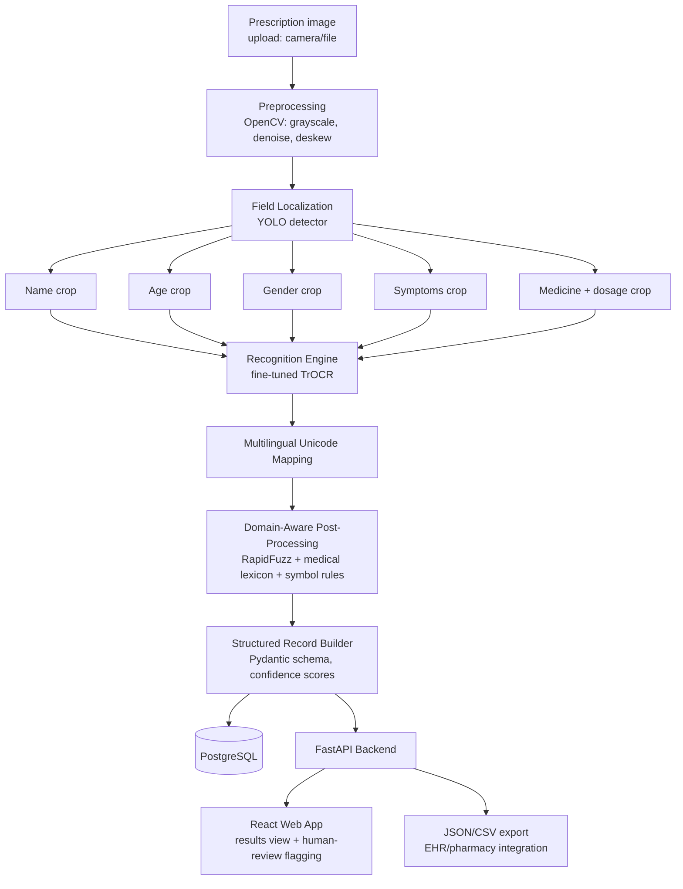
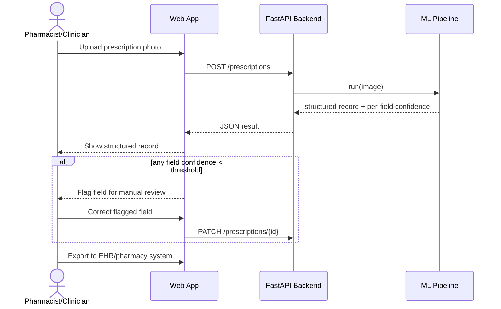
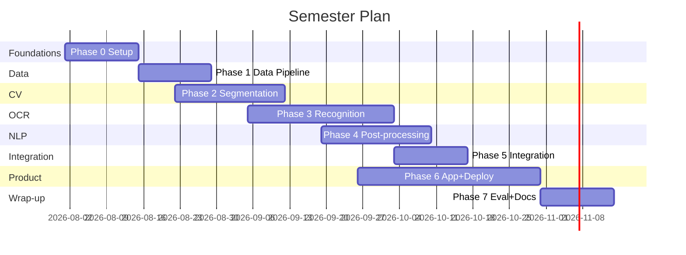

# AI-Based Multilingual Handwritten Prescription Recognition — Build Guide

This is the master index for building the project end-to-end, over one semester (~14–15 weeks), as a team of 4+. Each phase has its own detailed `.md` file — treat them as a build log you check off, not just reading material. Do the steps in order within a phase; phases overlap across pods (see below).

**Scope decision, made explicit up front:** the original synopsis's 9-month, 7-module scope is compressed here into a semester by (a) parallelizing across pods instead of doing everything serially, and (b) shipping an MVP first — full English + one regional language, one shared recognition model instead of five separate ones, YOLO-based field detection instead of Mask R-CNN/Detectron2 — with the heavier items (federated learning, doctor personalization, full regulatory-audit-grade privacy, additional languages) pushed to `08-stretch-goals.md`. This is a legitimate, defensible engineering trade-off for your report: state it explicitly rather than silently under-delivering against the synopsis.

## Files in this guide

| File | Covers | Rough weeks |
|---|---|---|
| `00-foundations-and-setup.md` | Repo, tooling, git workflow, cloud accounts, diagrams, dataset strategy sign-off | 1–2 |
| `01-data-strategy-and-pipeline.md` | Data sourcing (incl. the privacy-safe fallback), annotation, augmentation, DVC | 2–4 |
| `02-preprocessing-and-field-localization.md` | OpenCV preprocessing + YOLO field detector | 3–6 |
| `03-recognition-engine-ocr.md` | TrOCR fine-tuning, training on GPU (local + cloud) | 5–9 |
| `04-postprocessing-and-multilingual.md` | Lexicon validation, symbol-safety rules, Unicode multilingual layer | 7–10 |
| `05-integration-structured-records.md` | Unify modules into one pipeline, structured JSON/CSV output | 9–11 |
| `06-application-and-deployment.md` | FastAPI + Postgres + React (pnpm) app, Docker, cloud deploy | 8–13 |
| `07-evaluation-benchmarking-docs.md` | CER/WER/EMA evaluation, benchmark vs. the 6 papers, final report/demo | 13–15 |
| `08-stretch-goals.md` | Everything explicitly deferred out of the MVP | if time remains |

## Architecture

## User flow (what a pharmacist/clinician actually does)

## Tech stack (and why)

| Layer | Choice | Why |
|---|---|---|
| Python env/deps | **uv** | Single lockfile, fast installs, replaces pip+venv+poetry |
| Node/frontend deps | **pnpm** | Fast, disk-efficient, strict dependency resolution |
| Segmentation/field localization | **YOLOv8/YOLO11** (Ultralytics) instead of Mask R-CNN/Detectron2 | Detectron2 is notoriously painful to install on Windows; you only need bounding regions per field, not pixel masks, so a detector is sufficient and much faster to train on a semester timeline |
| Recognition | **TrOCR** (`microsoft/trocr-base-handwritten`) via Hugging Face Transformers | Best CER in the literature you reviewed; no explicit segmentation needed inside the model itself |
| Post-processing | **RapidFuzz** + curated lexicon | Fast Levenshtein/fuzzy matching, pure Python + C++ backend, no licensing issues |
| Backend | **FastAPI** | Async, typed (Pydantic), auto-generated OpenAPI docs — good for a multi-person team to integrate against |
| Database | **PostgreSQL** + SQLAlchemy + Alembic | Structured patient-record schema fits relational; migrations are a real production practice worth learning |
| Frontend | **React (Vite)** + pnpm + Tailwind | Fast dev loop, no framework lock-in needed for an MVP |
| Experiment tracking | **Weights & Biases** (free academic tier) | Every training run logged, comparable, reproducible |
| Data versioning | **DVC** + one cloud bucket | Keeps large files out of git, keeps your 20GB local disk free |
| Containerization | **Docker** + docker-compose | Consistent dev environment across 4+ laptops |
| CI | **GitHub Actions** | Lint + test on every PR |
| Cloud | **AWS as primary** (S3 + EC2 GPU spot instances), Azure/GCP credits as overflow | Keeps IAM/billing simple for one team; AWS skills are the most transferable |

## Team pods (adjust to your actual headcount)

- **Pod A — Data & MLOps** (1–2 people): dataset sourcing/synthesis, annotation, augmentation, DVC, cloud infra, CI, W&B setup
- **Pod B — Vision** (1 person): preprocessing + YOLO field detector
- **Pod C — Recognition** (1–2 people): TrOCR fine-tuning, training runs, evaluation
- **Pod D — NLP/Post-processing** (1 person): lexicon validation, symbol rules, multilingual mapping
- **Pod E — Product** (1–2 people): FastAPI backend, Postgres, React frontend, deployment

If you're exactly 4, merge B into C (one person owns the whole CV/OCR pipeline) and merge D into E temporarily until Phase 4.

## Git workflow (all phases)

- `main` is protected — no direct pushes, PR + 1 review required.
- Branch naming: `feat/<pod>-<short-description>` (e.g. `feat/vision-yolo-field-detector`), `fix/...`, `chore/...`, `docs/...`.
- **Conventional Commits**: `feat: add YOLO training script`, `fix: correct CER calculation`, `docs: add phase 3 notes`.
- One PR = one logical change. Squash-merge to keep `main`'s history readable.
- PR template (add as `.github/pull_request_template.md`, built in Phase 0) requires: what changed, how it was tested, screenshot/metric if applicable, linked issue.
- Tag a lightweight milestone at the end of each phase: `v0.1-foundations`, `v0.2-data`, `v0.3-segmentation`, etc.

## Timeline (15-week semester)

Start Phase 6 (app scaffolding, backend endpoints against a mocked pipeline) in parallel from week 4 — don't wait for the ML pipeline to be "done." That's the single biggest time-saver of working as a team instead of serially.

## How to use these files

Each phase file has: goals, exact setup commands, what "done" looks like, and a short "why" for every non-obvious tool choice — so you're learning the reasoning, not just copy-pasting. Work through `00` first regardless of pod; everyone needs the shared repo and tooling before splitting up.
