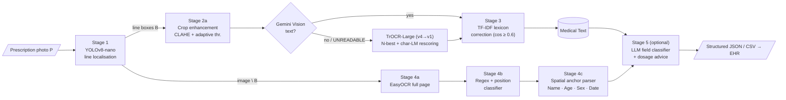
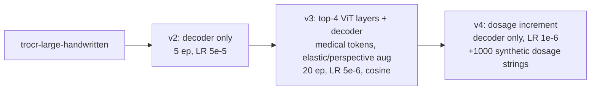

# Medi-Script-AI

**A hybrid detect–read–verify pipeline that digitises handwritten medical prescriptions into structured records.**

Medi-Script-AI localises handwritten medicine lines with **YOLOv8-nano**, reads them with a tiered recogniser (**Gemini Vision → fine-tuned TrOCR-Large + domain-LM rescoring**), verifies the text against a **384,604-entry medicine lexicon** (TF-IDF character n-grams), recovers printed and demographic text with **EasyOCR + regex + spatial anchors**, and optionally post-processes with a constrained **LLM** (field re-assignment, dosage explanation). Output is JSON/CSV ready for EHR integration.

> **Status: research prototype.** Not for clinical use. See [Limitations](#limitations) for what has and has not been measured.

📄 **Paper:** [`paper/main.pdf`](paper/main.pdf) (LaTeX source in [`paper/`](paper/)) · 🔬 **Novelty vs. the base paper:** [`docs/NOVELTY_ANALYSIS.md`](docs/NOVELTY_ANALYSIS.md)

---

## Table of contents
1. [Motivation](#1-motivation)
2. [Contributions and novelty](#2-contributions-and-novelty)
3. [System architecture](#3-system-architecture)
4. [Methodology](#4-methodology)
5. [Data](#5-data)
6. [Results](#6-results)
7. [Repository structure](#7-repository-structure)
8. [Installation](#8-installation)
9. [Usage](#9-usage)
10. [Training](#10-training)
11. [Limitations](#limitations)
12. [Roadmap](#roadmap)
13. [Citation, authors, licence](#citation)

---

## 1. Motivation
Illegible handwriting is a recognised cause of dispensing errors; the Institute of Medicine estimates that medication errors harm at least 1.5 million people a year in the US, costing hospitals at least \$3.5 billion in extra care. A prescription is a *semantically structured* document, so a practical digitiser must answer two questions in order: **where** is each piece of information, and **what** does it say?

Formally, for a photograph $P$ we want the record

$$R=\mathcal{F}(P)=(\text{doctor},\ \text{clinic},\ \text{date},\ \text{patient}=(\text{name},\text{age},\text{sex}),\ \mathcal{M},\ \text{other}),$$

where $\mathcal{M}$ is the ordered list of medicine lines (name, strength, dosage such as `1-0-1`). A fluent wrong drug is more dangerous than an empty field, so the design favours **verification and abstention**.

## 2. Contributions and novelty

The reference study is Biswas *et al.*, *"A novel approach of doctors' handwritten medical prescription recognition using a deep neural network and generating digital records of the patients"*, J. Dynamics and Games (2026), doi:10.3934/jdg.2026016 (CNN + MLP on >400,000 proprietary prescriptions). Medi-Script-AI is **not** claimed to be more accurate than it — the two are evaluated on different data. It differs in design:

| Aspect | Base paper | Medi-Script-AI |
|---|---|---|
| Localisation | contours + CNN–SVM printed/handwritten classifier | learned YOLOv8-nano line detector (6.2 MB) |
| Recognition unit | glyph/word *classification* per attribute (CNN features + MLP) | whole-line *sequence* recognition (TrOCR-Large / vision LLM) |
| Vocabulary | closed (trained classes) | open decoding, then constrained by a 384,604-entry lexicon |
| Knowledge verification | none reported | TF-IDF lexicon correction, char-LM beam rescoring, abstention gate |
| Dosage notation (`1-0-1 x 5 days`) | not modelled | synthetic-data fine-tuning (v4) + dosage-aware tokenisation |
| Printed / demographic fields | Tesseract + per-attribute models | EasyOCR + regex + **spatial anchor parser** (free layouts) |
| Post-processing | CSV | LLM field re-assignment + dosage explanation; JSON/CSV |
| Data & code | proprietary | public data, released code, API, Docker |

Full discussion, including what we **cannot** claim, is in [`docs/NOVELTY_ANALYSIS.md`](docs/NOVELTY_ANALYSIS.md).

## 3. System architecture



## 4. Methodology

| Stage | What it does | Key parameters |
|---|---|---|
| **1. Localisation** | YOLOv8-nano, single class (handwritten line) | conf ≥ 0.25, 5 px padding, 640² input |
| **2a. Enhancement** | upscale → gray → blur → CLAHE → adaptive threshold → dilate | ×2 Lanczos-4; CLAHE clip 2.5, 4×4; block 15, C 8; 2×2 kernel |
| **2b. Recognition** | Tier 1 Gemini Vision (prompted as a pharmacist, returns `UNREADABLE` if unsure) → Tier 2 TrOCR-Large (beam search, N-best) → rescoring | 2 beams, ≤ 24 tokens, no-repeat 3-gram |
| **Domain LM** | char trigram LM trained on the lexicons | $s_i=\tfrac{c_i}{100}+0.5\,\mathrm{LM}(t_i)+\mathbb 1[t_i\in\mathcal L]$ |
| **3. Lexicon correction** | char 2–4-gram TF-IDF, cosine retrieval, dosage-aware split | threshold cos ≥ 0.60; no-match ⇒ text kept |
| **4. Layout parsing** | EasyOCR (CRAFT+CRNN) minus YOLO regions; ordered regex/position rules; anchor search to the right (`|Δy|<30 px`) with fall-backs | OCR conf ≥ 15 %; IoA > 0.1 excluded |
| **5. LLM** | fills only *empty* fields; expands abbreviations (BD, OD, AC, HS…) — no diagnosis | Gemini 2.5 Flash, configurable |

Confidence fusion used by the field-level configuration:

$$c=\min\bigl(0.2\,c_{seg}+0.3\,c_{rec}+0.5\,c_{val},\ \min(c_{seg},c_{rec},c_{val})+15\bigr).$$

### TrOCR training lineage


## 5. Data

| Set | Train | Valid | Test | Notes |
|---|---:|---:|---:|---|
| `datasets/doctors-prescription-new` (D1) images / boxes | 884 / 3,976 | 219 / 972 | 135 / 556 | Roboflow export, class `Prescription` |
| `datasets/roboflow-bannari` (D2) images / boxes | 250 / 740 | 73 / 216 | 34 / 90 | Bannari Amman Inst. of Tech., CC BY 4.0 |
| `datasets/synthetic_trocr` | 3,531 word images | | | handwriting-font renderings of lexicon entries |

Roboflow exports contain augmented duplicates, so image counts overstate independent prescriptions. No patient data is collected; see [`data/DATASET_CARD.md`](data/DATASET_CARD.md) and [`data/DATA_MANIFEST.md`](data/DATA_MANIFEST.md). The full medicine lexicon is not redistributed — see [`data/lexicon/README.md`](data/lexicon/README.md).

## 6. Results

### Handwritten-line detection (YOLOv8-nano, D2, 50 epochs, Tesla T4)

| mAP50 | mAP50–95 | Precision | Recall | Train time | Model size | Inference |
|---:|---:|---:|---:|---:|---:|---:|
| **86.1 %** | 46.2 % | 81.9 % | 80.6 % | ~4 min | 6.2 MB | 2.5 ms / image (GPU) |

The mAP50 → mAP50–95 gap is typical of handwriting regions: boxes land on the right line with loose extent (loosely annotated data); recall trailing precision points to inconsistent labelling rather than too few epochs. CPU/edge latency has **not** been benchmarked.

### Qualitative end-to-end findings
* **Case A (in-distribution):** four medicine lines localised correctly; the then-untuned TrOCR output non-words at 32.5–53.8 % confidence; the lexicon gate declined to correct and the field stayed **empty** — a safe failure that isolates the fault to recognition.
* **Case B (out-of-distribution):** detector correct; TrOCR returned a fluent, high-confidence **unrelated commercial product name** — the hallucination mode that motivates LM rescoring and lexicon verification.
* **Baseline:** a Donut checkpoint trained on synthetic prescriptions emitted only full stops on a real photograph (complete synthetic-to-real collapse).

### Sample output
```json
{
  "DoctorName": "Dr: Sanjeev Saxena | M.B.B.S | S.M.o.",
  "Date": "17/7/24",
  "HospitalClinicInfo": "SENIOR MEDICAL OFFICER | MAHARAO BHIM SINGH HOSPITAL, KOTA",
  "Medical Text": ["Ozad : 100 BC 7 AM", "Ambulex\nPathil Prm 1OHHS", "RozuD.\nAmbulox 1 BD"],
  "Patient": {"Name": "Kamuna Chouhan", "Age": "36", "Sex": "F"},
  "Dosage Advice": "- Ozad: Take 100 before meals (BC) at 7 AM.\n- Ambulex: Take 1 tablet twice a day (BD)."
}
```
(The sample shows that uncorrected recogniser noise can still reach the output of the default path — see [Limitations](#limitations).)

## 7. Repository structure

```
Medi-Script-AI/
├── README.md · LICENSE · pyproject.toml · Dockerfile · .env.example
├── src/mediscript/                # installable Python package
│   ├── config.py                  # all paths & settings (env-overridable)
│   ├── pipeline.py                # end-to-end inference (run_heuristic_pipeline)
│   ├── detection/                 # (reserved) detector wrappers
│   ├── preprocessing/             # crop_enhancer.py, binarize.py
│   ├── recognition/               # trocr.py, gemini.py, domain_lm.py, lexicon_trie.py, reconciliation.py
│   ├── postprocessing/            # medical_lexicon.py (TF-IDF), lexicon.py, confidence.py
│   ├── parsing/                   # regex_classifier.py, record.py
│   ├── llm/                       # other_classifier.py, dosage_advice.py
│   ├── evaluation/                # metrics.py (CER / WER / exact match)
│   ├── data_gen/                  # synthetic words / dosage / prescriptions, auto-labelling
│   └── training/                  # TrOCR & YOLO training; colab/ = v2, v3, v4 notebooks-as-scripts
├── api/main.py                    # FastAPI service (POST /analyze)
├── frontend/index.html            # drag-and-drop web UI
├── scripts/                       # run_pipeline.py (CLI), visualize_pipeline.py, dataset helpers
├── experiments/                   # evaluation scripts
├── tests/                         # pytest suite
├── models/yolo/                   # yolo_real_world_best.pt (6.2 MB); TrOCR weights are not tracked
├── datasets/                      # doctors-prescription-new, roboflow-bannari, synthetic_trocr
├── data/                          # dataset card, manifest, lexicon/, samples/
├── assets/fonts/                  # handwriting fonts for synthetic data
├── notebooks/                     # Kaggle fine-tuning notebook
├── docs/                          # NOVELTY_ANALYSIS, PROJECT_HISTORY, build-guide/, training/
└── paper/                         # main.tex, figures/ (TikZ), references.bib, main.pdf
```

## 8. Installation

Requires Python ≥ 3.11 and a CUDA GPU is recommended (CPU works, slowly).

```bash
git clone https://github.com/Mahakisore7/Medi-Script-AI.git && cd Medi-Script-AI
python -m venv .venv && source .venv/bin/activate        # Windows: .venv\Scripts\activate
pip install -e ".[ml,llm,api,dev]"
cp .env.example .env                                      # add GEMINI_API_KEY (optional)
```

**Models / lexicon.** The YOLO detector ships in `models/yolo/`. Place fine-tuned TrOCR folders under `models/trocr/` (`final_trocr_large_model_v4_dosage`, `…_v3`, …); otherwise `microsoft/trocr-large-handwritten` is downloaded on first use. Put `medicines.csv` / `symptoms.csv` in `data/lexicon/` (see its README).

## 9. Usage

```bash
# Full pipeline with LLM post-processing (needs GEMINI_API_KEY)
python scripts/run_pipeline.py path/to/prescription.jpg

# Web service + UI
uvicorn api.main:app --host 0.0.0.0 --port 8000     # then open frontend/index.html
curl -F "file=@prescription.jpg" "http://localhost:8000/analyze?advice=false"

# Docker
docker build -t medi-script-ai . && docker run -p 8000:8000 --env-file .env medi-script-ai

# Tests
pytest
```

Without `GEMINI_API_KEY`, every crop takes the local TrOCR route and the LLM stages are skipped. Settings can be overridden with environment variables (see `.env.example`).

## 10. Training

```bash
python -m mediscript.training.train_yolo [path/to/data.yaml]         # detector
# TrOCR (GPU, Colab/Kaggle) — run in order:
#   src/mediscript/training/colab/train_trocr_v2.py            decoder-only
#   src/mediscript/training/colab/train_trocr_v3.py            cursive specialisation
#   src/mediscript/data_gen/synthetic_dosage_colab.py          make dosage data
#   src/mediscript/training/colab/train_trocr_v4_incremental.py
```
More notes: [`docs/training/`](docs/training/), and the original semester build guide in [`docs/build-guide/`](docs/build-guide/).

## Limitations
* **No end-to-end field-accuracy benchmark on real handwriting yet.** Only localisation is quantified; recognition evidence is qualitative.
* The abstention gate was validated in the field-level configuration; the **default page-level path keeps uncorrected text**.
* The best recogniser tier calls an external API (rate limits ≈ 20–40 s/prescription on the free tier; patient-data privacy implications). Use local-only mode for sensitive data.
* Small, loosely annotated detection data (357 images in D2); LLM pseudo-labels carry noise.
* English/Latin script, single detector class, assumes left-label → right-value layouts.
* Fine-tuned TrOCR weights and the 384K lexicon are not distributed with the repo.

## Roadmap
1. Label 200–300 real crops; report CER/WER/EM per tier with ablations (LM, lexicon, enhancement).
2. Multi-field detector (six classes) and a printed-vs-handwritten region classifier.
3. Distil the LLM tier into a local model; calibrate confidences; add human-review UI.
4. Multilingual scripts; FHIR export; CPU/edge benchmarks.

## Citation
```bibtex
@misc{medi-script-ai,
  title  = {Medi-Script-AI: A Hybrid Detect--Read--Verify Pipeline for Digitising Handwritten Medical Prescriptions into Structured Records},
  author = {Mahakisore M and Yashwanth B},
  year   = {2026},
  note   = {Course project, Deep Learning (22AIE304)},
  url    = {https://github.com/Mahakisore7/Medi-Script-AI}
}
```
**Authors:** Mahakisore M (CB.SC.U4AIE24333), Yashwanth B (CB.SC.U4AIE24360) — Department of Computer Science and Engineering (Artificial Intelligence).
**Licence:** see [LICENSE](LICENSE). Third-party data sets keep their own licences.

> **Security note:** earlier commits contained hard-coded API keys. They have been removed from the current tree but remain in git history — **rotate them** (Gemini, Roboflow).
