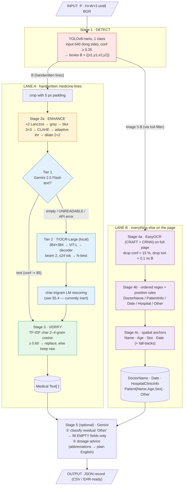

# Medi-Script-AI — Complete Architecture & Methodology Walkthrough

> Purpose: a single, end-to-end explanation of the pipeline for the mentor review — from the photo entering the system to the structured JSON leaving it, with tensor shapes, parameters, equations and worked numbers.
>
> Sources: the review deck (40 slides) and the code on branch `research/restructure-and-paper` (`src/mediscript/*`, `api/main.py`, training scripts, tests, recorded examples in `docs/examples/`).
>
> **Evidence labels used throughout**
> - **[CODE]** read directly from the repository source
> - **[DECK]** stated in the review deck / paper (not re-derivable from the repo, e.g. YOLO metrics)
> - **[DERIVED]** computed by me from [CODE] parameters (arithmetic you can re-do)
> - **[RECORDED]** taken from a recorded run in `docs/examples/`
> - **[ILLUSTRATIVE]** toy numbers computed with the same settings to show the mechanism, *not* results of the real system

---

## 0. The idea in one paragraph

A prescription is a *structured* document, so we answer two questions separately: **where** is each piece of information, and **what** does it say. A learned detector finds the handwritten medicine lines. Each line is read by a tiered recogniser (vision-LLM, falling back to a local fine-tuned TrOCR) and then verified against a 384,604-name medicine lexicon. Everything *outside* those lines (printed header, doctor, patient demographics, date) goes down a second path: full-page OCR → ordered rules → spatial anchor parsing. An optional constrained LLM fills only still-empty fields and translates dosage abbreviations. Design principle: **a fluent wrong drug name is more dangerous than an empty field → prefer to abstain.**

Formal task (deck slide 4):

```
R = F(P) = ( doctor, clinic, date, patient=(name, age, sex), M, other )
P  : one RGB photograph,  P ∈ {0..255}^(H × W × 3)
M  : ordered list of medicine lines, each = (name, strength, dosage e.g. "1-0-1 x 5 days")
```

---

## 1. Input specification

| Item | Value | Source |
|---|---|---|
| Input | One photograph/scan of a prescription (JPG/PNG/…) | [CODE] `api/main.py` |
| Decoder | `cv2.imread` / `cv2.imdecode(..., IMREAD_COLOR)` | [CODE] |
| In-memory form | `numpy.ndarray`, shape `(H, W, 3)`, dtype `uint8`, **BGR channel order** (OpenCV) | [CODE] |
| Size constraint | None. Any resolution is accepted; scale is handled per stage (see §3–§5) | [CODE] |
| Recorded test sizes | Sample 1: **768 × 1024** (W×H); Sample 2: **1227 × 1600** | [RECORDED] measured from `docs/examples/*/yolo_crops.jpg` |
| Entry points | `POST /api/upload` (dashboard; pipeline **+ LLM stages**), `POST /analyze?advice=true|false` (pipeline; LLM optional), `GET /health`, CLI `scripts/run_pipeline.py` | [CODE] |
| Core function | `run_heuristic_pipeline(image, yolo_weights_path=None, label_path=None, output_dir=None) -> dict` | [CODE] `pipeline.py` |
| Test hook | `label_path`: if a YOLO-format label file exists, ground-truth boxes **replace** the detector (used to test downstream stages in isolation) | [CODE] |

**Nothing is resized globally.** There is no page-level normalisation: the YOLO model letterboxes internally, every crop is rescaled for its own reader, and EasyOCR works on the original image. All coordinates after Stage 1 are in the **original pixel space** of `P`.

---

## 2. Master architecture

### 2.1 Block diagram (stage colours match the deck)



### 2.2 Tensor / data flow table (one prescription, nominal sizes)

| # | Stage | Input (shape / type) | Operation | Output (shape / type) |
|---|---|---|---|---|
| 0 | Load | file bytes | decode | `P: (H,W,3) uint8` |
| 1 | Detect | `P` | letterbox → YOLOv8n → NMS | `B: list[(x1,y1,x2,y2)]` ints, orig. coords |
| 2a | Enhance (per box) | `crop: (h+10, w+10, 3)` (≤5 px pad each side) | ×2 resize → gray → blur → CLAHE → adaptive thr → dilate | `(2h', 2w', 3) uint8`, values ∈ {0,255} (BGR, 3 identical channels) |
| 2b-T1 | Gemini | enhanced crop → PNG bytes | prompt + image → text | `(str, 85.0)` or `("", 0.0)` |
| 2b-T2 | TrOCR | enhanced crop → PIL RGB | resize 384×384, normalise → ViT → decoder beam search | N-best `[(str, conf∈[0,100])] × 2` → best `(str, conf)` |
| 3 | Verify | `str` | TF-IDF cosine retrieval on lexicon | corrected `str` |
| 4a | Page OCR | `P` | CRAFT detect + CRNN read | `[(polygon, text, conf∈[0,1])]` |
| 4b | Classify | fragment text + normalised centre `(x/W, y/H)` | ordered regex + position prior | label ∈ {DoctorName, PatientInfo, Date, HospitalClinicInfo, Other} |
| 4c | Anchor parse | fragment boxes `{text,x1,y1,x2,y2,cx,cy}` | label→value search within ±Δy | `Patient{Name,Age,Sex}`, `Date` |
| 5 | LLM | record dict | JSON-constrained classifier + advice | final `dict` |

---

## 3. Stage 1 — DETECT (YOLOv8-nano)

**Question answered:** *where* is each handwritten medicine line? (requirement R1)

### 3.1 Model

| Property | Value | Source |
|---|---|---|
| Architecture | YOLOv8-nano, anchor-free, decoupled head | [DECK] |
| Parameters / compute | **3.0 M params, 8.1 GFLOPs** at 640×640 | [DECK] |
| Classes | **1** ("Prescription" = handwritten line) | [CODE] dataset yaml, [DECK] |
| Checkpoint | `models/yolo/yolo_real_world_best.pt`, **6.2 MB** (6,249,706 bytes) | [CODE] file size |
| Init | COCO-pretrained `yolov8n.pt` | [CODE] `train_yolo.py` |
| Inference call | `model(image, verbose=False, conf=0.25)` | [CODE] |
| Confidence threshold | **0.25** | [CODE] |
| NMS IoU, max detections | Ultralytics defaults (0.7, 300) — not overridden | [DERIVED] from library defaults |
| Weights cached | `lru_cache` → loaded once per process | [CODE] |

### 3.2 Input → output dimensions

Ultralytics letterboxes so the **long side = 640**, keeping aspect ratio, padding the short side to a multiple of 32 (rectangular inference).

| Recorded sample | Original W×H | Scale r = 640 / max(W,H) | Network input (W×H) | Prediction cells |
|---|---|---|---|---|
| Sample 1 | 768 × 1024 | 0.625 | **480 × 640** (no padding: 480 = 15×32) | 60×80 + 30×40 + 15×20 = **6,300** |
| Sample 2 | 1227 × 1600 | 0.400 | 491 → padded to **512 × 640** | 64×80 + 32×40 + 16×20 = **6,720** |
| Nominal square | 640 × 640 | 1 | 640 × 640 | 80² + 40² + 20² = **8,400** |

[DERIVED] Strides are 8/16/32, so grid sizes are (H/8×W/8)+(H/16×W/16)+(H/32×W/32). Each cell predicts `4 box coords + 1 class score = 5` channels → raw output `(1, 5, N_cells)`. After the 0.25 score filter and NMS, boxes are mapped back to original pixels by undoing the scale and padding, then cast to `int`.

**Output:** `B = [(x1,y1,x2,y2), …]` — integer pixel corners in the original image. Zero boxes is a valid outcome (see §10 failure paths).

### 3.3 Detection metrics (what we report)

```
IoU(b, g)  = |b ∩ g| / |b ∪ g|            a detection is correct if IoU ≥ τ
Precision  = TP / (TP+FP)                  Recall = TP / (TP+FN)
AP         = ∫ P(R) dR                     mAP50 = AP at τ=0.5
mAP50–95   = mean of AP over τ ∈ {0.50,0.55,…,0.95}   (10 thresholds)
```

| Metric | Value | Source |
|---|---|---|
| mAP50 | **86.1 %** | [DECK] measured, D2 test split |
| mAP50–95 | **46.2 %** | [DECK] |
| Precision / Recall | **81.9 % / 80.6 %** | [DECK] |
| Latency | **2.5 ms / image**, Tesla T4 (GPU only; CPU/edge not measured) | [DECK] |
| Training cost | ≈ 4 min on a T4 (0.067 GPU-h) | [DECK] |

How to read it: the 39.9-point gap between mAP50 and mAP50–95 means boxes land on the right line but with loose extent (handwriting strokes bleed past annotated edges). Recall < precision suggests inconsistent labelling (overlapping/omitted lines), so curating labels is a better lever than more epochs.

### 3.4 Worked example — Sample 1 detector output [RECORDED]

Box edges were measured from the red rectangles in `docs/examples/1/yolo_crops.jpg` (±3 px; the overlay is the pipeline's own drawing). Five boxes, reading order top→bottom, **overlapping each other vertically**:

| # | Box (x1,y1,x2,y2) | w × h | Area (px²) | % of page (768×1024 = 786,432) |
|---|---|---|---|---|
| 1 | (398, 328, 708, 382) | 310 × 54 | 16,740 | 2.13 % |
| 2 | (398, 368, 598, 420) | 200 × 52 | 10,400 | 1.32 % |
| 3 | (391, 404, 606, 458) | 215 × 54 | 11,610 | 1.48 % |
| 4 | (390, 444, 645, 504) | 255 × 60 | 15,300 | 1.95 % |
| 5 | (386, 480, 684, 536) | 298 × 56 | 16,688 | 2.12 % |
| | **Total** | | **70,738** | **≈ 9.0 %** |

So the handwritten medicine block is only ≈ 9 % of the page area; the other ≈ 91 % goes to Lane B.

---

## 4. Stage 2a — ENHANCE (per-crop image conditioning)

**Why:** handwriting crops are small, low-contrast, unevenly lit (phone shadows, flash). The ViT/LLM read better with larger glyphs, local contrast and connected strokes.

### 4.1 Cropping

```
pad = 5
c_x1 = max(0, x1 − 5)    c_y1 = max(0, y1 − 5)
c_x2 = min(W, x2 + 5)    c_y2 = min(H, y2 + 5)
crop = image[c_y1:c_y2, c_x1:c_x2]            # skipped if crop.size == 0
```

### 4.2 The chain (in code order) [CODE] `preprocessing/crop_enhancer.py`

| Step | Operation | Parameters | Shape / dtype after |
|---|---|---|---|
| 1 | Upscale | factor **×2**, `INTER_LANCZOS4` | `(2h, 2w, 3)` uint8 |
| 2 | Grayscale | `0.299 R + 0.587 G + 0.114 B` | `(2h, 2w)` |
| 3 | Denoise | Gaussian blur **3×3**, σ auto | same |
| 4 | CLAHE | `clipLimit = 2.5`, `tileGridSize = (4,4)` | same |
| 5 | Adaptive threshold | `ADAPTIVE_THRESH_GAUSSIAN_C`, `THRESH_BINARY`, **blockSize = 15, C = 8** | `(2h,2w)` ∈ {0,255} |
| 6 | Dilate | kernel **2×2**, 1 iteration (thickens thin strokes) | same |
| 7 | Back to 3-channel | `GRAY2BGR` | `(2h, 2w, 3)` |

Adaptive threshold, per pixel `(x,y)` with Gaussian-weighted local mean over the 15×15 window Ω:

```
T(x,y) = Σ_{(i,j)∈Ω} w_ij · I_clahe(x+i, y+j)  −  C          (C = 8)
out(x,y) = 255  if I_clahe(x,y) > T(x,y)  else 0
```

A pixel turns **white** if it is brighter than its local weighted mean minus 8 grey levels; ink (darker than surroundings) turns black. This is why it survives uneven lighting.

Design history [DECK/CODE comment]: `fastNlMeansDenoising` was replaced by the Gaussian blur because it scaled as O(N²) and hung on large crops.

**Why local, not global Otsu (base paper):** Otsu picks one page-wide `T = argmin ω₁σ₁² + ω₂σ₂²`; a single `T` fails under shadow/flash. We threshold per crop *and* per 15×15 neighbourhood.

### 4.3 Worked example — shapes for the five Sample 1 crops [DERIVED]

| # | Padded crop (w×h) | After ×2 (w×h) | Aspect ratio w:h |
|---|---|---|---|
| 1 | 320 × 64 | **640 × 128** | 5.00 |
| 2 | 210 × 62 | **420 × 124** | 3.39 |
| 3 | 225 × 64 | **450 × 128** | 3.52 |
| 4 | 265 × 70 | **530 × 140** | 3.79 |
| 5 | 308 × 66 | **616 × 132** | 4.67 |

*(Box 1 example: 310+10 = 320 wide, 54+10 = 64 tall → ×2 = 640 × 128.)*

> **Measured?** No. The effect of enhancement on recognition error has **not** been ablated (needs a transcribed crop set). [DECK]

---

## 5. Stage 2b — READ (tiered recogniser)

**Question answered:** *what* does each line say, open-vocabulary, including dosage? (requirement R2)

### 5.1 Tier selection logic [CODE] `pipeline.py`

```
text, conf = recognize_with_gemini(crop)             # Tier 1
if not text:                                          # "", UNREADABLE, N/A, UNCLEAR, any API error
    text, conf = recognize_text(crop, use_base_model=False, field_type="medicine")   # Tier 2 (TrOCR)
corrected, _ = correct_medicine_crop(text)            # Stage 3
Medical Text.append(corrected)
```
- No API key → Tier 1 raises internally, is caught, returns `("",0.0)` → **every crop goes to TrOCR** (offline mode).
- **Tier 3 (abstain)** exists in the deck's design: no text from either reader → empty string. The *confidence-gated* drop is **not wired into this path** (§11).

### 5.2 Tier 1 — Gemini vision [CODE] `recognition/gemini.py`

| Item | Value |
|---|---|
| Model | `gemini-2.5-flash` (env `MEDISCRIPT_GEMINI_MODEL`) |
| Image sent | enhanced crop, BGR→RGB, PNG bytes |
| Prompt | "expert pharmacist reading a handwritten prescription crop; output the text exactly as written; no explanation/markdown; output exactly `UNREADABLE` if blank/illegible" |
| Pre-call delay | `LLM_DELAY_S = 4 s` (free-tier rate limit; set 0 on paid) |
| Retry | once, after **10 s**, on HTTP 429/503 |
| Returned confidence | **fixed pseudo-confidence 85.0** (Gemini gives no probability) |
| Failure | `("", 0.0)` → falls through to TrOCR |
| Latency note | ≈ 20–40 s per prescription on free tier [DECK] — e.g. 5 crops × (4 s delay + call) |
| Privacy | crops leave the machine; local-only mode = no API key |

### 5.3 Tier 2 — TrOCR-Large (local)

**Checkpoint order** [CODE] `config.py`: `v3 → v2 → v1(final_trocr_large_model) → microsoft/trocr-large-handwritten`; **v4 (dosage) only if `MEDISCRIPT_USE_V4=1`**. Weights are not in the repo; without them the public base model downloads on first use.

**Architecture** (HF `trocr-large-handwritten` config; verified):

| Block | Spec |
|---|---|
| Image preprocessing | resize **384 × 384**, rescale 1/255, normalise mean = std = 0.5 → values ∈ [−1, 1] |
| Encoder | **ViT-Large/16**: 24 layers, hidden **1024**, 16 heads, FFN 4096, patch **16×16** |
| Visual tokens | (384/16)² = 24 × 24 = **576 patch tokens** (+ CLS) each ∈ ℝ¹⁰²⁴ |
| Decoder | Transformer decoder: **12 layers**, d_model 1024, 16 heads, FFN 4096, cross-attention to encoder, learned positions (512), vocab **50,265** (RoBERTa BPE) |
| Size | ≈ 558 M parameters (TrOCR paper) |

**Forward pass** with crop `C` (enhanced, e.g. 640×128):
1. `C → PIL RGB → resize to 384×384` → tensor `(1, 3, 384, 384)`
2. Patchify → `(1, 576, 768)` raw patches → linear projection → `(1, 576, 1024)` (+ pos. embedding)
3. 24 × self-attention blocks: `Attention(Q,K,V) = softmax(QKᵀ/√d_k)·V`, d_k = 1024/16 = 64 → `E(C) ∈ ℝ^(577×1024)`
4. Autoregressive decoding: `p(t | C) = ∏ᵢ p(tᵢ | t_<i, E(C))`, cross-attending to `E(C)`

**Generation settings** [CODE]:

| Parameter | Value |
|---|---|
| `num_beams` | **2** |
| `num_return_sequences` | **2** for `field_type="medicine"` (else 1) → the **N-best list, N = 2** |
| `max_new_tokens` | **24** |
| `no_repeat_ngram_size` | 3 |
| `length_penalty` | 1.0, `early_stopping=True` |
| Constrained decoding | prefix-allowed-tokens trie **disabled** (100× slower on CPU) |
| Device | CUDA if available else CPU; model cached as singleton |

**Hypothesis confidence:** `cᵢ = 100 × mean_t p(token_t)` over finite token probabilities (from `compute_transition_scores`, normalised logits). Fallback 50.0 if scores unavailable.

> **Aspect-ratio note [DERIVED] (worth raising with the mentor).** TrOCR's processor resizes to a **square 384×384 without preserving aspect ratio**. Our crops are wide strips (3.4:1 to 5:1), so the horizontal axis is compressed and the vertical stretched:
>
> | Crop (after ×2) | x-scale | y-scale |
> |---|---|---|
> | #1  640 × 128 | 0.600 | 3.000 |
> | #2  420 × 124 | 0.914 | 3.097 |
> | #3  450 × 128 | 0.853 | 3.000 |
> | #4  530 × 140 | 0.725 | 2.743 |
> | #5  616 × 132 | 0.623 | 2.909 |
>
> This is the standard TrOCR protocol (the base model was trained that way), so it is consistent with pre-training, but it means the ×2 upscaling mostly helps by smoothing, not by adding horizontal resolution.

### 5.4 Domain language-model rescoring of the N-best list

Design [CODE] `recognition/domain_lm.py`: character **trigram** LM (n = 3) built from the medicine + symptom lexicons, padded `^^word$`, Laplace smoothing.

```
LM(t) = (1/|t|) Σ_k  log [ (count(g_k) + 1) / (count(ctx_k) + |V| + 1) ]       g_k = k-th char trigram, ctx_k = its 2-char prefix
s_i   = 1.0 · (c_i/100)  +  0.5 · LM(t_i)  +  1.0 · 1[t_i ∈ lexicon]            (lexicon bonus only for medicine/symptoms)
t*    = argmax_i s_i          → returns (t*, original c_i)
```

| Weight | Value |
|---|---|
| visual `w_trocr` | 1.0 |
| LM `w_lm` | 0.5 |
| lexicon bonus `w_lexicon` | 1.0 (applies only if the *whole* lower-cased hypothesis is a lexicon entry) |

Intended behaviour: a general-language decoder prefers fluent English; the LM prefers strings that *look like drug names character by character*.

> **⚠ Verified defect on this branch.** In `DomainLM.__init__` the lexicon is loaded only `if lexicons.medicines_trie:` — but `MedicalLexicons.__init__` sets `medicines_trie = None` and only builds it when `get_medicines_trie()` is called, which the LM never does. I ran the class against a 3-entry test lexicon: result `lexicon_words = 0, vocab_size = 0, ngrams = 0`, `LM(t) = 0.0` for *every* string, and the lexicon bonus never fires. Consequence: **`rescore_beams` degenerates to "pick the beam with the highest TrOCR confidence"**. The deck lists this component as "Implemented; no ablation" — accurate wording is "implemented but currently not active; fix is one line (load via `get_medicines_trie()` / check file existence)". Details in §12.

### 5.5 Illustrative rescoring arithmetic [ILLUSTRATIVE — assumed inputs]

Suppose the N-best list is `("Ambulax", 70.0)` and `("Ambutax", 72.0)`, and the LM gives `LM("Ambulax") = −1.8`, `LM("Ambutax") = −2.6`, and "Ambulax" ∈ lexicon:

```
s₁ (Ambulax) = 70/100 + 0.5·(−1.8) + 1 = 0.70 − 0.90 + 1.00 = 0.80
s₂ (Ambutax) = 72/100 + 0.5·(−2.6) + 0   = 0.72 − 1.30        = −0.58
→ choose "Ambulax", return confidence 70.0
```
The raw visual score alone would have picked "Ambutax" (72 > 70); the domain terms flip it. (This is what the component *should* do once the loader bug is fixed.)

---

## 6. Stage 3 — VERIFY (TF-IDF lexicon correction)

**Question answered:** is the reading a real drug name, and if it is a near-miss, which one? (requirement R3)

### 6.1 Index (built once at import) [CODE] `postprocessing/medical_lexicon.py`

| Item | Value |
|---|---|
| Lexicon | **384,604** Indian medicine brand/full names (`data/lexicon/medicines.csv`, **not committed** — built by `scripts/fetch_lexicon.py` from the Kaggle A–Z Indian Medicine set: brand = first word, plus full name, title-cased, de-duplicated) |
| Vectoriser | `TfidfVectorizer(analyzer="char_wb", ngram_range=(2,4))` |
| `char_wb` | n-grams only inside word boundaries, each word padded with one space on each side |
| Weighting | `tfidf(g,e) = tf(g,e) · idf(g)`, `idf(g) = ln((1+N)/(1+df(g))) + 1` (scikit-learn smoothed), then **L2-normalised** |
| Matrix | sparse `(384,604 × |vocab|)`; one `cosine_similarity(query, matrix)` = one sparse mat-vec product |
| Without the CSV | stage is skipped and recognised text is returned as read |

N-gram counts per word [DERIVED]: a word of length *L* padded to *L+2* characters yields `(L+1) + L + (L−1) = 3L` n-grams over n = 2,3,4.
- `Ambutax` (L=7) → 8 + 7 + 6 = **21** n-grams · `Amoxcilin` (L=9) → **27** · `Amoxicillin` (L=11) → **33**.

### 6.2 Algorithm [CODE] `correct_medicine_name(text, threshold=60)`

1. Strip `" .,;:-()"`; if length < 3 → return unchanged.
2. Split into whitespace tokens. **Break** the token stream at any token that (a) contains a digit, or (b) is a dosage keyword: `tab, cap, syr, syp, syrup, inj, iv, oral, suspension, tablet, capsule, drop(s), ointment, cream, bd, od, tds, sos, hs, ac, pc, mg, ml, gm, per, mcg`. Single-letter tokens are ignored.
   Each remaining run of consecutive words is a **candidate sequence**; strengths and frequencies are never touched.
3. For each sequence, try every prefix of words (`n = len … 1`; candidate must be ≥ 3 chars). Score each with cosine; keep the **highest-scoring prefix that reaches the threshold** (score = cosine × 100 ≥ 60, i.e. **cos ≥ 0.60**).
4. Replace the matched original tokens in place with the lexicon entry (case-insensitive regex, first occurrence).
5. If nothing reaches 0.60 → **raw text kept** (no forced guess).

Cosine: `cos(q,e) = (q · e) / (‖q‖‖e‖)` with L2-normalised vectors, so `cos = q·e`.

### 6.3 Validation confidence assigned [CODE] `correct_medicine_crop`

| Outcome | `c_val` |
|---|---|
| Text changed (strong lexicon match) | **90** |
| Text kept unchanged | **55** (so it passes the 50 filter; "trust the reading") |
| No match (used by `validate_field` path) | **10** |
| Empty input | 0 |

### 6.4 Illustrative cosine example [ILLUSTRATIVE]

Computed with the **same vectoriser settings** on a 10-name toy lexicon (so IDF differs from the real 384,604-name corpus — absolute values on the real index will differ; the point is the mechanism and the 0.60 gate):

| Query (OCR) | Best toy match | cosine | Decision (gate 0.60) |
|---|---|---|---|
| `ambutax` | Ambulax | 0.722 | replace |
| `amoxcilin` | Amoxicillin | 0.702 | replace |
| `rozac` | Rozat | 0.735 | replace |
| `placid` | Placida | 0.802 | replace |
| `xzyqqq` | — | 0.000 | **keep raw** |

Token-level trace for a real recorded reading `Rozac-ID 40 mc 7 Am` [RECORDED reading, rule applied by hand]: tokens → `Rozac-ID` (candidate), `40` (digit → break), `mc` (2 chars → ignored), `7` (break), `Am` (2 chars → ignored). Only `Rozac-ID` (query `rozac-id`) is looked up; `40 mc 7 Am` is preserved verbatim.

### 6.5 Other lexicon utilities in the repo

| Component | Role | Used in default path? |
|---|---|---|
| `validate_field()` symbol repairs `(\d)[Hh](\d) → \1+\2` (`1H1`→`1+1`), `(mg|g|ml)(\d+)(mg|g|ml) → …/…` (`400mg16mg`→`400mg/16mg`) | repair OCR damage in dosage tokens | **No** — pipeline calls `correct_medicine_crop` directly, bypassing it (§12) |
| `parse_dosage()` (`H→+`, `l→1`, `O→0` only inside digit-heavy tokens) | dosage-glyph repair | **No** — defined, never called |
| RapidFuzz `WRatio` + first-letter index (threshold 60) | small lexicons (gender, symptoms) | only via `validate_field` (not default path) |
| `LexiconTrie` (O(k) exact/prefix lookup) | constrained-decoding scaffold; reconciliation | not on the default path |
| `reconcile_predictions()` (TrOCR vs EasyOCR agreement, fuzz ratio > 85) | cross-check | **No** — not called |

---

## 7. Stage 4 — LANE B: printed text, header and patient demographics

**Question answered:** everything that is *not* a handwritten medicine line — doctor, clinic, date, patient name/age/sex. (requirements R1/R5)

### 7.1 4a — Page OCR and routing [CODE]

| Item | Value |
|---|---|
| Engine | EasyOCR, language `["en"]`, `gpu=torch.cuda.is_available()`; CRAFT text detector + CRNN recogniser; cached |
| Call | `reader.readtext(image, detail=1, paragraph=False)` on the **original full page** (not enhanced) |
| Per fragment | `(polygon, text, conf ∈ [0,1])` → axis-aligned box `x1,x2 = min/max xs`, `y1,y2 = min/max ys`, centre `(cx,cy)` |
| Confidence filter | drop if `conf × 100 < 15` (`MIN_OCR_CONFIDENCE = 15`) |
| Lane routing (IoA) | drop fragment `b` if `max_j |b ∩ B_j| / |b| > 0.1` — fragments **>10 % inside any YOLO box** belong to Lane A |

```
IoA(b, B) = max_j  area(b ∩ B_j) / area(b)          skip fragment if IoA > 0.10
```

**Worked IoA [ILLUSTRATIVE geometry on the recorded Sample 1 boxes]:**
- Fragment `(410,335,520,375)` vs Box 1 `(398,328,708,382)`: intersection = 110×40 = 4,400 = fragment area → **IoA = 1.00 > 0.10 → skipped** (it is part of a handwritten medicine line).
- Fragment in the header, e.g. `(500,30,730,55)` vs all boxes: intersection 0 → **IoA = 0 → kept** for classification.

### 7.2 4b — Ordered rule classifier [CODE] `parsing/regex_classifier.py`

Normalised centre: `y' = cy/H`, `x' = cx/W` (0 = top/left). **First matching rule wins:**

| Order | Class | Rule |
|---|---|---|
| 1 | `DoctorName` | `\b(dr\.?\|md\b\|mbbs\b\|prof\.?)` |
| 2 | `PatientInfo` | `\b(name\|namc\|age\|ag\|gender\|sex\|patient)\b`; or `\d{1,3}\s*[/-]\s*[mf…]` (e.g. `28/M`); or `\d{1,3}\s*yrs?` |
| 3 | `Date` | `\bdate\b`; or `\d{1,2}[/-]\d{1,2}[/-]\d{2,4}`; or, if the *whole* string is 6–10 chars of `[\d\-./]` **and** `y' < 0.25` **and** `x' > 0.6` |
| 4 | `DoctorName` / `HospitalClinicInfo` | only inside the **position prior**: `y' < 0.25` (top band) **or** `y' > 0.8` (bottom band) **or** `x' < 0.25` (left margin); then doctor keywords (`dr, doctor, m.b.b.s, s.m.o`) → Doctor; hospital keywords (`hospital, clinic, care, health, medical, ph, mob, reg, chc, phc, institute, centre`) → Hospital; **or ≥ 2 words** → Hospital |
| 5 | `Other` | fall-through |

`PatientInfo` fragments are *not* stored as text; they are consumed by the spatial parser (§7.3). Hospital/Doctor/Other fragments are joined with `" | "`.

**Position prior in pixels for Sample 1 (768×1024) [DERIVED]:** top band `y < 256`, bottom band `y > 819`, left margin `x < 192`, top-right date zone `y < 256 ∧ x > 461`. The header block ("MAHARAO BHIM SINGH HOSPITAL, KOTA", "SENIOR MEDICAL OFFICER") sits at y ≈ 100–130 → top band → Hospital. The footer address (y ≈ 1000) → bottom band → Hospital.

### 7.3 4c — Spatial anchor parser (Name / Age / Sex / Date)

Printed labels ("Name", "Age", "Sex", "Date") are **anchors**; the handwritten value is the nearest fragment to the right within a vertical tolerance Δ on the box centre:

```
value(a) = argmin_{b : b.x1 ≥ a.x2  ∧  |b.cy − a.cy| < Δ}  (b.x1 − a.x2)
```

| Field | Δ (px) | Extra rule |
|---|---|---|
| default (`find_closest_right`) | **30** | nearest in horizontal gap |
| Name (join several words) | **15** | take *all* boxes to the right, sorted by x, until the **Sex anchor's x1** (found within Δ 25 of the Name row) |
| Sex | **45** | accept `f/female/m/male`; or ≤ 2-char box starting with f/m |
| Date | **75** | people write dates floating above/below the line; boxes containing a digit and one of `/ . -` get a **−1000 distance bonus** (strongly preferred) |

Anchor recognition = regex **or** RapidFuzz `ratio ≥ 75` per word (e.g. `Namc` → Name).

**Fall-backs when OCR misses the anchor** [CODE]:

| # | Fall-back | Example |
|---|---|---|
| 1 | Title ⇒ name: `mr / mrs / ms / mast / master` | "Mrs. Karuna …" → name |
| 2 | Compact age/sex: `(\d{1,3})\s*(yrs\|yr\|y\|years)?\s*/\s*([mMfF])` | `28/M` → Age 28, Sex M |
| 3 | Implicit date: `[0-9A-Za-z]{1,2}[./-]…[./-]…{2,4}` (tolerates letter-for-digit OCR errors) | `12/10/22` |
| 4 | Age typo repair: `(\d)7\s*/\s*[FMfm]` → `\1 yr / \2` | `47/F` → `4 yr / F` → Age **4** |
| 5 | Date typo repair: `(\d{1,2})1(\d{1,2}[/-]\d{2,4})` → `\1/\2` | `1717/24` → `17/7/24` |
| 6 | Sex re-read: crop right of the Sex label (x from anchor x2 to `min(next-anchor x, x2+150)`, y ± 10 px) and run **TrOCR** | any `f/F` → F, `m/M` → M *(loose: a stray letter 'f' anywhere counts)* |

**Recorded result, Sample 1 [RECORDED]:** `Date = 17/7/24`, `Sex = F`, `Age = 36`, `Name = "kaxutna choakanin_"` (handwriting reads closer to "Karuna chouhan" on the overlay → the *structure* is right but the *reading* is noisy; this is the "recognition is the bottleneck" finding). Note also that Lane B has no verification: the name goes through no lexicon.

> **Leak to be aware of:** handwriting that is *not* a medicine line (e.g. "BP: 130/90", "SpO2", "Diet", "walk/exercise" on Sample 1) is not boxed by YOLO, so EasyOCR reads it as low-quality fragments that land in `Other` ("36 | 60 | 3 | R; | Cp. | …").

---

## 8. Stage 5 — EXPLAIN (optional, constrained LLM)

Runs only on `/api/upload`, or `/analyze?advice=true`, and only with `GEMINI_API_KEY`. Each call sleeps `LLM_DELAY_S` (4 s) first. **Any API failure leaves the record unchanged.**

| Sub-stage | Input | Output | Constraints |
|---|---|---|---|
| ① Other-field classifier (`llm/other_classifier.py`) | residual `Other` string (fragments separated by `\|`) | strict JSON `{PatientName, Age, Sex, DoctorName, Date, HospitalClinicInfo, RemainingOther}` (markdown fences stripped) | fills **only empty** fields (DoctorName, Date, Patient.Name/Age/Sex); `HospitalClinicInfo` is **appended** with `" \| "`; a doctor name must carry an explicit title (Dr., Doctor) else it is a patient name; unclassifiable text → `RemainingOther` |
| ② Dosage-advice generator (`llm/dosage_advice.py`) | list of `Medical Text` lines | plain-English bullets | prompt forbids diagnosis/advice beyond translating abbreviations; empty list → "No medicines detected…" |

Prompt example (from the prompt itself): `["Cap. Rozat 10D AC 7AM", "T. Ambulax 1 BD"]` →
`- Rozat 10D (Capsule): Take 1 before meals (AC) at 7 AM.` / `- Ambulax (Tablet): Take 1 twice a day (BD).`

**Observed [RECORDED]:** in all three recorded outputs the advice call returned `"Unable to generate dosage advice at this time (LLM Error)."` — the fallback path worked (record otherwise intact) but **this stage is not evaluated.**

---

## 9. Output specification

```jsonc
{
  "DoctorName":         "Dr: Sanjeev Saxena | M.B.B.S | S.M.o.",   // str, ' | '-joined fragments
  "Date":               "17/7/24",                                  // str
  "HospitalClinicInfo": "SENIOR MEDICAL OFFICER | MAHARAO BHIM SINGH HOSPITAL, KOTA | …",
  "Medical Text":       ["Rozac-ID 40 mc 7 Am", "Pantil per 1 days", …],   // list[str], DETECTION order (not page order)
  "Other":              "…residual fragments…",
  "Patient":            { "Name": "…", "Age": "36", "Sex": "F" },
  "Dosage Advice":      "…"                                         // only when LLM stage ran
}
```
Side artefacts when `output_dir` is given: `yolo_crops.jpg` (red YOLO boxes) and `easyocr.jpg` (green EasyOCR polygons). Persisted per request under `outputs/<uuid>/`. CSV/EHR export is a downstream mapping of this dict; FHIR export is roadmap.

---

## 10. Decision logic and failure paths (what happens when…)

| Situation | Behaviour |
|---|---|
| YOLO weights missing | warning, `[]` boxes → Lane A empty |
| **No boxes** (conf < 0.25 everywhere) | "classify everything via regex": all OCR fragments are processed in Lane B; `Medical Text = []` |
| Crop empty after padding | Lane-A step skipped |
| Enhancement throws | warning, **un-enhanced crop** is used |
| No `GEMINI_API_KEY` / 429 / 503 twice / UNREADABLE | TrOCR tier |
| TrOCR checkpoints missing | base `microsoft/trocr-large-handwritten` downloaded |
| TrOCR model failed to load | returns `("dummy_text", 50.0)` *(note: placeholder text can reach output)* |
| TrOCR generation exception | `("", 0.0)` → empty string |
| Lexicon CSV missing | Stage 3 skipped; raw text kept |
| Lexicon cos < 0.60 | raw text kept (never force-corrects) |
| EasyOCR fragment conf < 15 % | discarded |
| LLM error / bad JSON | record unchanged; advice = fallback message |

---

## 11. Confidence fusion and the abstention gate (field-level configuration)

Three signals, each scaled 0–100:

| Signal | Source | Value |
|---|---|---|
| `c_seg` | detector confidence | YOLO box score (≥ 25) |
| `c_rec` | reader | Gemini fixed **85**; TrOCR = mean token prob × 100 |
| `c_val` | lexicon | **90** changed / **55** kept / **10** no match |

```
c = min( 0.2·c_seg + 0.3·c_rec + 0.5·c_val ,   min(c_seg, c_rec, c_val) + 15 )
Drop the field if  c < 15   OR   (prescription field AND c_val < 50)      # likely hallucination
```

**Min-anchor property:** one very weak stage cannot hide behind two strong ones.

| Case | (c_seg, c_rec, c_val) | weighted | anchor = min+15 | **c** | Gate |
|---|---|---|---|---|---|
| unit test, all high [CODE test] | (90, 90, 90) | 90.0 | 105 | **90.0** | keep |
| unit test, validation fails [CODE test] | (100, 100, 10) | 55 | 25 | **25.0** | `c_val < 50` → **drop** |
| Gemini read, lexicon corrected [ILLUSTRATIVE] | (86, 85, 90) | 87.7 | 100 | **87.7** | keep |
| Gemini read, kept as-is [ILLUSTRATIVE] | (86, 85, 55) | 70.0 | 70 | **70.0** | keep |
| Case A: non-word, conf 40 [ILLUSTRATIVE] | (80, 40, 10) | 33.0 | 25 | **25.0** | `c_val < 50` → **drop** |

**Honest status:** `combined_confidence` is implemented and unit-tested (the 25.0 example), and was validated in the earlier field-level configuration (case study A). **The default page-level path (`run_heuristic_pipeline`) does not call it**, so noisy text can still reach the output. Porting the gate + a risk–coverage curve is Phase 3 of the roadmap.

---

## 12. Training (how each learned component was built)

### 12.1 Detector (YOLOv8-nano)

| Item | Reported run [DECK] | Released script default [CODE] `training/train_yolo.py` |
|---|---|---|
| Data | **D2** Bannari Amman, 357 images / 1,046 boxes (250/73/34 images; 740/216/90 boxes) | D1 `doctors-prescription-new` (1,238 images / 5,504 boxes; 884/219/135) |
| Epochs | **50** | **30** |
| Image size / batch | 640 | 640 / 8 |
| Early stopping | patience 10 | patience 10 |
| Init | COCO `yolov8n.pt` | COCO `yolov8n.pt` |
| Augmentation | library defaults (mosaic, colour) | library defaults |
| Hardware / time | Tesla T4, ≈ 4 min | — |

⚠ The headline metrics (86.1 / 46.2 / 81.9 / 80.6) come from the *D2 / 50-epoch* run, but the shipped script defaults to *D1 / 30 epochs*. To reproduce the numbers, run it with D2's `data.yaml` and `epochs=50` (see §13).

### 12.2 TrOCR lineage (all start from `microsoft/trocr-large-handwritten`)

| Setting | v2 · decoder only | v3 · cursive | v4 · dosage (incremental on v3) |
|---|---|---|---|
| Trainable | decoder | **top-4 ViT layers (layers 20–23 of 24) + decoder** | decoder (encoder frozen) |
| Epochs (max) | 5 | 20 | 5 |
| Learning rate | 5×10⁻⁵ | 5×10⁻⁶ | 1×10⁻⁶ |
| Per-device batch × grad-accum | 8 × 2 = 16 | 4 × 2 = 8 | 4 (deck) |
| Scheduler | linear, warm-up 50 steps | **cosine, 10 % warm-up** | default |
| Early-stop patience | 3 | 5 | 2 |
| Max label length | 64 tokens | 128 | — |
| Weight decay / grad clip | 0.01 / — | 0.01 / **1.0** | — |
| Precision | fp16 on GPU | fp16 on GPU | fp16 |
| Augmentation | rot ±3°, colour jitter (b 0.2, c 0.2), blur σ 0.1–1.0 | + **perspective 0.15 (p 0.5)**, rot ±5°, **elastic (α 60, σ 6; p 0.5)**, jitter (b 0.3, c 0.4, s 0.1), blur σ 0.1–1.5 | perspective, rotation |
| Vocabulary | base | **~170 frequent drug names injected as single tokens** (`tokenizer.add_tokens`; embedding matrix resized) | inherits v3 |
| Data | pseudo-labelled YOLO crops (image, text) | same + more | v3 data + **1,000 synthetic dosage strings** |
| Split / selection | 85 / 15, `random_state = 42`; best checkpoint by **CER**, reloaded at end | same | same |

**Objective** (token-level cross-entropy, pad masked to −100):

```
L = − (1/|T|) Σ_{t∈T} log p_θ(y_t | y_<t, E(C))          T = non-pad target tokens
```

**v3 schedule** (warm-up 10 %, then cosine to 0):

```
lr(s) = lr_peak · s / s_w                                   for s < s_w
lr(s) = lr_peak · ½ · (1 + cos(π (s − s_w)/(S − s_w)))      for s ≥ s_w         lr_peak = 5×10⁻⁶
S = ⌊N_train / (4·2)⌋ · 20,     s_w = ⌊0.10 · S⌋
```
Example [ILLUSTRATIVE — N_train not in repo; assume 1,000]: steps/epoch = 125, S = 2,500, s_w = 250.

**Why this recipe (the "unlock capacity while lowering LR" idea):** v2 trains only the decoder so the encoder keeps its generic stroke features; v3 unlocks 4 encoder layers to learn cursive but drops the learning rate 10× (5e-5 → 5e-6) to avoid catastrophic forgetting; v4 adds dosage syntax at 1e-6 with the encoder frozen again.

> **Status:** weights and a real-handwriting CER benchmark for v2–v4 are **not released**; on `main` the default loader uses **v3**; v4 is opt-in.

### 12.3 Synthetic data

| Set | Recipe | Size |
|---|---|---|
| **Words** (`synthetic_words.py`) | every lexicon entry × **3 styles**; **6 handwriting fonts** (Pacifico, Kalam, Indie Flower, Patrick Hand, Reenie Beanie, Shadows Into Light); font size 32–48 px; ink ∈ {#000000, #111111, #0b2e6b, #1a1a2e}; rotation ±3°; blur 0.5–1.0; height normalised to **64 px**, JPEG quality 85–95 | **3,531** images |
| **Dosage** (`synthetic_dosage_colab.py`) | 13 frequency patterns (`1-0-1`, `1 - 0 - 1`, `1-1-1`, `0-1-0`, `1-0-0`, `0-0-1`, `1-1-1-1`, `2-0-2`, `1/2 - 0 - 1/2` …) × 13 durations (`x 5 days`, `x 7 days`, `x 1 week`, `for 5 days` …, ~70 % of strings carry one); **4 cursive fonts** (Pacifico, Permanent Marker, Amatic SC, Sacramento), 40–70 px, off-white paper, black/navy pen | **1,000** images (TrOCR v4) |
| **Pseudo-labelled crops** (`auto_label.py`) | YOLO boxes → crop → vision-LLM transcription (4.1 s sleep for rate limit) → `labels.csv` (Images, Text) | for v2, v3 |

**Consistency check [DERIVED]:** 3,531 = 3 × 1,177 = 3 × (1,142 medicines + 35 symptoms). So the synthetic word set was generated from the **early 1,142-name lexicon**, while inference uses the **384,604-name** lexicon — this is exactly the "reconcile lexicon size (1,142 vs 384,604)" open item. Caveat: font-rendered handwriting is cleaner than real handwriting; it teaches syntax (e.g. `1-0-1`), not stroke variability.

---

## 13. Datasets and ethics

| Dataset | Content | Size | Used for |
|---|---|---|---|
| **D2** Bannari Amman (Roboflow, CC BY 4.0) | handwritten lines, class "Prescription" | 357 images / 1,046 boxes (250/73/34) | detector training **and reported metrics** |
| **D1** Doctors-prescription-new (Roboflow) | same class, larger export | 1,238 images / 5,504 boxes (884/219/135) | pipeline development |
| Pseudo-labelled crops | YOLO crops transcribed by a vision-LLM | table for Colab | TrOCR v2, v3 |
| Synthetic words | lexicon × fonts | 3,531 | TrOCR |
| Synthetic dosage | frequency × duration strings | 1,000 | TrOCR v4 |
| RxHandBD | public Bangladeshi prescription word images | public set | frozen-encoder run |

Caveats: Roboflow exports include augmented duplicates (same image, different hash) → image counts overstate independent prescriptions. Only public, de-identified data; no patient records collected. **Crops sent to the LLM tier leave the machine** → sensitive deployments must stay local-only.

---

## 14. Complete worked trace — Sample 1 (Maharao Bhim Singh Hospital, Kota) [RECORDED + DERIVED]

Input: **768 × 1024 × 3** uint8 photograph (786,432 pixels), one hospital prescription with a bilingual printed header, handwritten Name/Sex/Age/Date, and five handwritten medicine lines.

| Step | What happens | Numbers |
|---|---|---|
| 1 | Load | `P: (1024, 768, 3)` BGR |
| 2 | **YOLO** letterbox 768×1024 → **480×640**, r = 0.625 | 6,300 prediction cells, conf ≥ 0.25 → **5 boxes** (≈ 9.0 % of page area) |
| 3 | **Crop + pad 5 px** | 320×64, 210×62, 225×64, 265×70, 308×66 |
| 4 | **Enhance** ×2 → gray → blur → CLAHE (2.5, 4×4) → thr (15, 8) → dilate | 640×128, 420×124, 450×128, 530×140, 616×132 |
| 5 | **Gemini** per crop (4 s delay, conf := 85); on failure → **TrOCR** (384×384 → 576 tokens → 2 beams, ≤ 24 tokens) | 5 readings, e.g. `Rozac-ID 40 mc 7 Am`, `Ambutax 1 BD` |
| 6 | **Lexicon verify** (cos ≥ 0.60 → replace, else keep; digits/dosage tokens untouched) | strengths `40`, `1 BD` preserved |
| 7 | **EasyOCR** on the full 768×1024 page | green fragments; drop conf < 15 %; drop IoA > 0.1 (all fragments inside the five boxes) |
| 8 | **Rule classifier** with position prior (top band y < 256, bottom y > 819, left x < 192) | header → Hospital; "Dr: Sanjeev Saxena", "M.B.B.S", "S.M.o." → Doctor |
| 9 | **Anchors** Name / Sex / Age / Date, Δ = 15 / 45 / 30 / 75 px | Date `17/7/24`, Sex `F`, Age `36`, Name `kaxutna choakanin_` |
| 10 | **LLM**: classify `Other`, advice | advice call returned the error fallback |
| 11 | **Record** | below |

Final recorded record (abridged) [RECORDED `docs/examples/1/output_llm.json`]:
```
Medical Text : ["Rozac-ID 40 mc 7 Am", "Pantil per 1 days", "Rosciato 40  1OD 6 in",
                "Ambutax 1 BD", "Placid - 10 mg BD 6/12"]
DoctorName   : "Dr: Sanjeev Saxena | M.B.B.S | S.M.o."
Date         : "17/7/24"
Patient      : {Name: "kaxutna choakanin_", Age: "36", Sex: "F"}
```
**What it shows:** structure is right (all five lines found; header, doctor, date, sex recovered; frequencies like `BD` preserved) but *recognition is noisy* (name, several drug tokens). No ground truth exists for this page, so **no error rate is claimed**.

### 14b. Sample 2 (dental prescription, 1227 × 1600) [RECORDED + DERIVED]

- Letterbox: r = 0.40 → 491 → padded **512 × 640**, 6,720 cells.
- Four boxes detected (measured from overlay): (467,411,1147,647) 680×236; (491,653,1161,841) 670×188; (509,897,1133,1055) 624×158; (227,1125,1053,1251) 826×126.
- Output: `Augmentin 625mg 1 - 0 - 1 x 5 days`, `Pan-D 40mg 1-0-0 x 5 days`, `Enzoflam 1-0-1 x 5days` — **dosage syntax survives** end-to-end; age 28 / sex M recovered from the `28/m` compact pattern (fall-back #2).
- Failures: name misread (`Sachn LSansose`), date `12/10/22` missed, `Urimate 1 x 5 Days` has no clear counterpart on the page (a fluent unsupported line — exactly what verification + abstention are meant to catch), advice call errored. One run, an illustration, **not a benchmark**.

---

## 15. Evidence status (what you can and cannot claim)

| Component | Evidence | Status |
|---|---|---|
| YOLO detector | mAP50 86.1 %, mAP50–95 46.2 %, P 81.9 %, R 80.6 % (D2, 357 images) | **Measured** |
| Lexicon gate | Case A: non-words (32.5–53.8 % conf) not forced onto a drug name | Observed |
| Spatial parser | two recorded outputs, no labelled benchmark | Observed |
| Crop enhancement | implemented; no ablation | Not evaluated |
| TrOCR v2–v4 | trained; weights and real-handwriting CER not released | Not evaluated |
| Gemini tier | implemented; accuracy not measured | Not evaluated |
| Domain LM + trie | **currently inert (§5.4)**; no ablation | Not evaluated |
| LLM stage | advice call errored in all recorded runs | Not evaluated |
| End-to-end fields | no transcribed real-prescription benchmark | **Not measured** |

**Positioning vs Biswas et al. (2026):** they report 90.20 % overall, 97.3 % printed-vs-handwritten, per-attribute 88.6–96.8 % on > 400,000 *proprietary* samples with fixed classes. We report **localisation** only (mAP50 86.1 %) on a 357-image public set. These are different quantities on different data → **no accuracy-superiority claim**; the argument is architectural (open vocabulary, verification/abstention, dosage + layout handling, reproducibility).

---

## 16. Code ↔ deck reconciliation (read before the review)

These are things I found by reading the code that the deck either states more strongly than the code supports or does not mention. Each has a quick fix; the first two deserve a decision before you present.

| # | Finding | Where | Impact | Fix |
|---|---|---|---|---|
| 1 | **Domain-LM never loads its lexicon.** Guard `if lexicons.medicines_trie:` is always falsy (`None` until `get_medicines_trie()` is called). Verified by running it: `vocab_size = 0`, `LM(t) = 0` for all strings, lexicon bonus never fires → rescoring = "highest TrOCR confidence". | `recognition/domain_lm.py` | Deck slides 18 & 33 describe an active component | Replace the two guards with `os.path.exists(path)` (or call `get_*_trie()`); rerun; then ablate |
| 2 | **Detector script ≠ reported run.** Script defaults: D1, 30 epochs. Metrics: D2, 50 epochs. | `training/train_yolo.py` vs README/deck | Reproducibility of the headline number | Make D2 / 50 epochs the default (or add flags) and commit the `data.yaml` |
| 3 | **Train/inference preprocessing mismatch (TrOCR).** v2/v3 were trained on **raw** YOLO crops (`auto_label.py` saves the unmodified crop), but at inference TrOCR receives the **binarised, dilated** enhanced crop. A pre-trained ViT may handle this worse than a grey crop. | `pipeline.py` + `auto_label.py` | Possible accuracy loss on Tier 2; also relevant to the planned enhancement ablation | Ablate: raw crop vs enhanced crop into TrOCR (and Gemini) |
| 4 | **Symbol repairs not in default path.** `1H1→1+1` and `400mg16mg→400mg/16mg` live in `validate_field`; `parse_dosage` is unused; pipeline calls `correct_medicine_crop` directly. | `confidence.py`, `medical_lexicon.py` | Deck slide 19 lists them under Stage 3 | Call `validate_field("medicine", …)` in the pipeline |
| 5 | **Abstention gate / `combined_confidence` / `reconcile_predictions` not called** by the page-level pipeline. | `pipeline.py` | Already disclosed in deck (slides 17, 20, 35) | Roadmap Phase 3 |
| 6 | **Prefix selection wording.** Deck: "longest prefix first". Code: tries all prefixes and keeps the **highest-scoring** prefix that reaches 0.60. | `correct_medicine_name` | Minor wording | Say "best-scoring prefix ≥ 0.60" |
| 7 | **Lexicon size inconsistency.** Synthetic words built from 1,142 medicines (3,531 = 3 × 1,177); verification uses 384,604. `medicines.csv` is not committed. | data | Already an open item in deck | Regenerate synthetic words from the full lexicon or state it |
| 8 | **Tier-2 sex re-read is loose** (`"f" in text` ⇒ F). | `pipeline.py` | Could mislabel sex from noise | Require whole-word / ≤ 2 chars |
| 9 | **Non-medicine handwriting leaks into `Other`** (BP, SpO2, diet notes). | design | Noisy `Other` field; LLM stage may mis-assign | Multi-class detector (roadmap Phase 2) |
| 10 | **Placeholder text on model-load failure** (`"dummy_text", 50.0`). | `recognition/trocr.py` | Could emit fake text instead of abstaining | Return `("", 0.0)` |
| 11 | Secrets in git history; tests written but not yet run. | repo | Already in deck open items | Rotate keys; `pip install -e ".[ml,llm,api,dev]" && pytest` |

---

## 17. Likely mentor questions — short, honest answers

**Why a detector + reader instead of an end-to-end document model (Donut/LayoutLMv3)?**
It separates *where* from *what*, so each stage trains on its own small dataset and fails visibly. A Donut model trained only on synthetic prescriptions emitted only full stops on a real photograph (complete synthetic-to-real collapse).

**Why TF-IDF over character n-grams instead of Levenshtein?**
Levenshtein against 384,604 names per crop is too slow; one sparse mat-vec product with L2-normalised vectors gives cosine for all names at once, and char 2–4-grams tolerate insertions, deletions and substitutions (`Amoxcilin → Amoxicillin`).

**Why 0.60?**
It is an empirical gate: high enough to refuse non-words (`xzyqqq` → 0.0 in the toy run) and low enough to rescue one- or two-character errors (0.70–0.80 in the toy run). It has **not** been tuned on a labelled set — the risk–coverage curve in Phase 3 is how we would justify it.

**Where does the 0.2 / 0.3 / 0.5 weighting come from?**
It is a design choice weighted toward validation (a real vocabulary check). The min-anchor term (+15) is what guarantees a single failed stage can't be averaged away. Not calibrated yet.

**What is actually new?**
The combination: learned line detector + open-vocabulary line reader + large-lexicon verification with abstention + layout-aware parsing, as a reproducible offline-capable package. We do **not** claim higher accuracy than the base paper.

**What is your biggest risk?**
No end-to-end accuracy number on real handwriting. The single most valuable next step is a 200–300-crop transcribed set with CER / WER / exact-match **per tier** plus ablations (enhancement, LM, lexicon).

**Is the external LLM acceptable for medical data?**
Tier 1 and Stage 5 send crops/text off-machine. Local-only mode (no key) uses TrOCR + rules; the roadmap distils the LLM tier into a local model. We ask the mentor to decide whether an external tier is acceptable.

---

## 18. Number cheat-sheet

| Group | Numbers |
|---|---|
| Detector | 1 class · 3.0 M params · 8.1 GFLOPs · 640 input · conf 0.25 · pad 5 px · 6.2 MB · 2.5 ms (T4) · mAP50 86.1 · mAP50–95 46.2 · P 81.9 · R 80.6 |
| Enhancement | ×2 Lanczos-4 · Gaussian 3×3 · CLAHE clip 2.5, 4×4 · adaptive Gaussian thr block 15, C 8 · dilate 2×2 |
| TrOCR | 384×384 · 16×16 patches · 576 tokens · ViT-L 24 layers, 1024 hidden, 16 heads · decoder 12 layers · vocab 50,265 · beams 2 · ≤ 24 tokens · no-repeat 3-gram · conf = mean token prob × 100 |
| Gemini | 2.5 Flash · fixed conf 85 · delay 4 s · retry after 10 s on 429/503 |
| Domain LM | char trigram · Laplace · weights 1.0 / 0.5 / 1.0 (visual / LM / lexicon) — *loader bug, §5.4* |
| Lexicon | 384,604 names · char_wb 2–4-grams · cos ≥ 0.60 · c_val 90 / 55 / 10 · symptoms 35 |
| Page OCR | EasyOCR conf ≥ 15 % · IoA > 0.1 → Lane A · position prior y < 0.25, y > 0.8, x < 0.25 |
| Anchors | Δy = 30 default / 15 name / 45 sex / 75 date · fuzzy anchor ≥ 75 |
| Fusion | 0.2 / 0.3 / 0.5 · anchor min + 15 · drop if c < 15 or c_val < 50 · test: (100,100,10) → 25 |
| TrOCR training | v2: 5 ep, 5e-5 · v3: 20 ep, 5e-6, top-4 ViT, ~170 tokens · v4: 5 ep, 1e-6, +1,000 dosage images · split 85/15, seed 42 |
| Data | D2 357 img / 1,046 boxes · D1 1,238 img / 5,504 boxes · synthetic words 3,531 · dosage 1,000 |
| Base paper | > 400,000 proprietary samples · 90.20 % overall · 97.3 % print-vs-hand (not comparable) |
