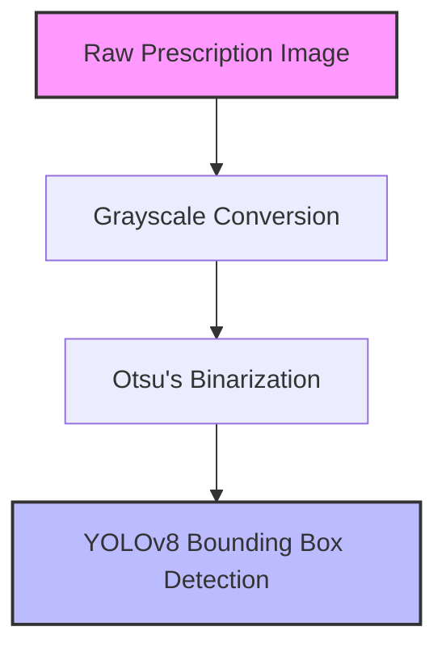
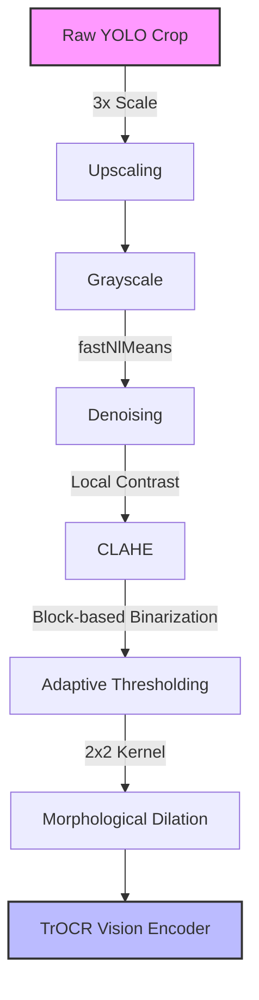

# Preprocessing Techniques for Handwriting Recognition

Handwritten medical prescriptions present extreme challenges for traditional Computer Vision and OCR models. They often feature highly connected cursive, thin pen strokes, uneven lighting (shadows/flash), and degraded paper quality.

To maximize the accuracy of our **TrOCR-Large** model, the Medi-Script-AI pipeline implements a two-stage preprocessing architecture.

---

## Stage 1: Global Image Preprocessing

Before the image is passed to the YOLOv8 object detection model, we apply a lightweight global preprocessing pass. This helps the segmentation model isolate the text lines from the background noise.

1. **Grayscale Conversion (`cv2.cvtColor`)**
   - Removes color channels, reducing the computational load and focusing the model purely on luminance and contrast.
2. **Otsu's Thresholding (`cv2.THRESH_OTSU`)**
   - Automatically calculates the optimal global threshold value to binarize the image (pure black and white), helping text regions stand out sharply against the paper background.

---

## Stage 2: Aggressive Crop Enhancement

Once YOLOv8 extracts a bounding box (a "crop") containing a single line of text (e.g., a specific medicine name), we apply aggressive, localized enhancement before passing it to the TrOCR Vision Encoder.

> [!IMPORTANT]
> **Why enhance the crop locally?**
> A global threshold often fails because prescriptions have uneven lighting. By applying advanced filters directly to the small cropped region, we can dynamically adjust to the local lighting conditions of that specific word.

### Step-by-Step Breakdown:

1. **Upscaling (300%)**
   - **Problem:** Transformer-based OCR models (like TrOCR) struggle with very low-resolution bounding boxes.
   - **Solution:** We artificially blow up the crop by 3x using `cv2.INTER_LANCZOS4` interpolation, giving the ViT (Vision Transformer) larger patches to analyze.

2. **Denoising (`fastNlMeansDenoising`)**
   - **Problem:** High-resolution scans often contain paper grain, while phone photos contain ISO noise.
   - **Solution:** We strip out the noise while preserving the sharp edges of the pen strokes.

3. **CLAHE (Contrast Limited Adaptive Histogram Equalization)**
   - **Problem:** Standard contrast adjustments blow out highlights or crush shadows.
   - **Solution:** CLAHE divides the image into small tiles and applies contrast enhancement locally. This perfectly normalizes shadows cast by a phone camera.

4. **Adaptive Gaussian Thresholding**
   - **Problem:** A single threshold value will ruin the crop if one side of the word is darker than the other.
   - **Solution:** We binarize the crop adaptively. The threshold value is calculated for small pixel neighborhoods, ensuring the pen strokes become pure black regardless of the background shade.

5. **Morphological Dilation**
   - **Problem:** Doctors often write quickly with thin ballpoint pens. When binarized, these thin strokes can break apart, confusing the OCR model.
   - **Solution:** We pass a `2x2` pixel kernel over the image to dilate (thicken) the black pixels. This acts like a "bold" filter, connecting broken cursive strokes and making them highly legible for the TrOCR encoder.
