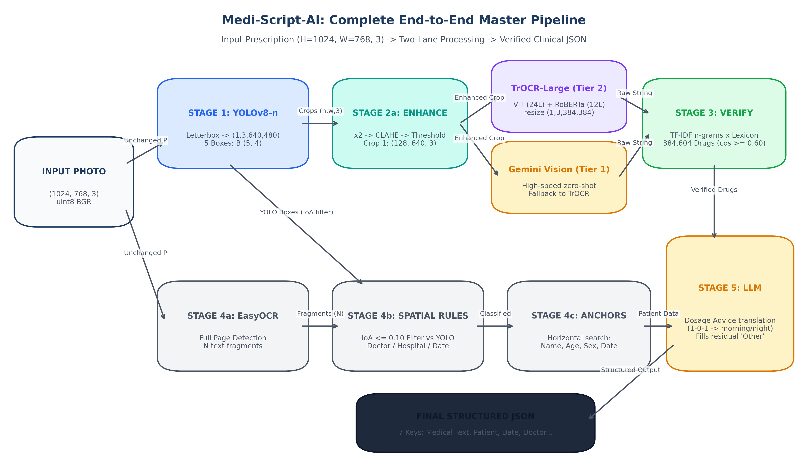
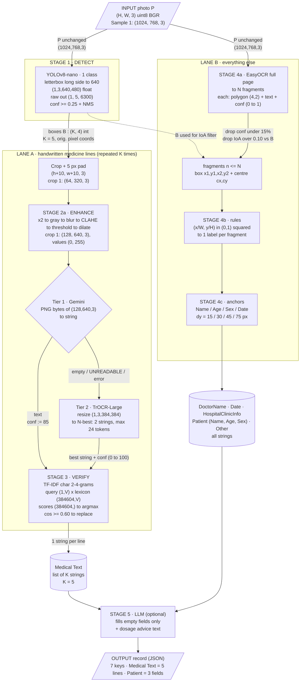
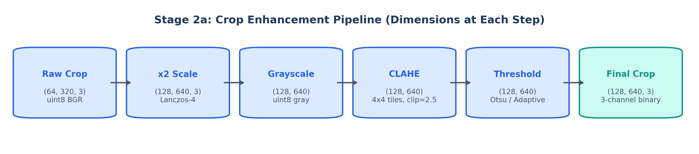
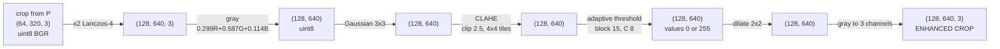
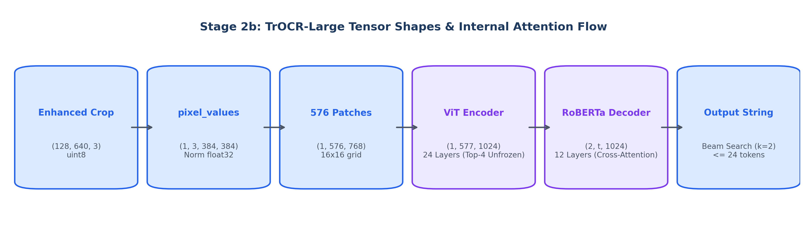
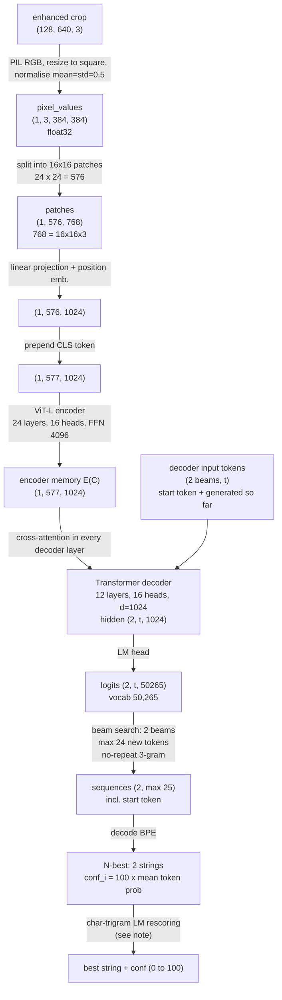
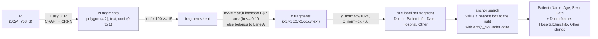
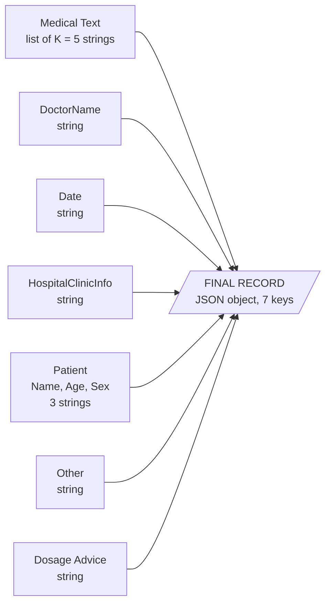

# Medi-Script-AI — Architecture Diagram with Dimensions

How one prescription photo flows through the system, what shape it has at every hop, how it changes, and what finally comes out.

**Notation.** `H×W×3` = height × width × channels. Tensors are written `(batch, …)`.
**Worked values** use recorded Sample 1: `H = 1024, W = 768`, 5 detected lines (box coordinates measured from the recorded overlay, ±3 px). Crop 1 is used as the running example.
Everything below is read from the code (`pipeline.py`, `crop_enhancer.py`, `trocr.py`, `medical_lexicon.py`, …) or derived from its parameters.

---

## 1. Master diagram (every arrow carries its shape)





---

## 2. Stage 1 — Detect: image → boxes

```
P (1024, 768, 3) uint8
      │  letterbox: r = 640 / max(H,W) = 0.625
      ▼
resized (640, 480, 3)     (768×0.625 = 480; 480 is a multiple of 32 → no padding)
      │  /255, HWC→CHW, add batch
      ▼
input tensor (1, 3, 640, 480) float32
      │  YOLOv8-nano backbone + neck + head (strides 8 / 16 / 32)
      ▼
 grid 80×60 = 4800   +   40×30 = 1200   +   20×15 = 300   =  6300 cells
      │  each cell → 4 box values + 1 class score
      ▼
raw output (1, 5, 6300)
      │  keep score ≥ 0.25  →  NMS
      ▼
K detections → map back (÷ 0.625, remove padding) → cast int
      ▼
B : (K, 4) int   =  [(x1,y1,x2,y2), …]      K = 5 for Sample 1
```

| # | Box (x1, y1, x2, y2) | w × h | Area px² |
|---|---|---|---|
| 1 | (398, 328, 708, 382) | 310 × 54 | 16,740 |
| 2 | (398, 368, 598, 420) | 200 × 52 | 10,400 |
| 3 | (391, 404, 606, 458) | 215 × 54 | 11,610 |
| 4 | (390, 444, 645, 504) | 255 × 60 | 15,300 |
| 5 | (386, 480, 684, 536) | 298 × 56 | 16,688 |

Total 70,738 px² ≈ **9.0 %** of the page (786,432 px²). The other ≈ 91 % goes to Lane B.

Other input sizes (same rule): `1227×1600` → scale 0.40 → 491 → padded to `(1,3,640,512)`, 6,720 cells. A `640×640` image → 8,400 cells.

---

## 3. Stage 2a — Enhance: how a crop changes (crop 1)





Crop padding rule: `x1−5 … x2+5`, `y1−5 … y2+5`, clamped to the image.

| Line | Box w×h | Padded crop | After ×2 (enhanced) |
|---|---|---|---|
| 1 | 310 × 54 | 320 × 64 | **640 × 128** |
| 2 | 200 × 52 | 210 × 62 | **420 × 124** |
| 3 | 215 × 54 | 225 × 64 | **450 × 128** |
| 4 | 255 × 60 | 265 × 70 | **530 × 140** |
| 5 | 298 × 56 | 308 × 66 | **616 × 132** |

(table sizes are `w × h`.) The enhanced crop is the input to **both** readers.

---

## 4. Stage 2b — Read

### 4.1 Tier 1: Gemini

```
enhanced crop (128, 640, 3) BGR → RGB → PNG bytes
      │  prompt: "expert pharmacist … output text exactly … UNREADABLE if illegible"
      ▼
text string (variable length)       confidence := 85 (fixed)
      └─ empty / UNREADABLE / N/A / UNCLEAR / API error  →  Tier 2
```

### 4.2 Tier 2: TrOCR-Large — internal tensor shapes





**Squash note.** The enhanced crop is wide (e.g. 640×128, ratio 5:1) but TrOCR resizes to a **square** 384×384, so for crop 1 the horizontal scale is 0.600 and the vertical scale 3.000 (crop 2: 0.914 / 3.097, crop 3: 0.853 / 3.000, crop 4: 0.725 / 2.743, crop 5: 0.623 / 2.909).

**Rescoring note.** Score is `c/100 + 0.5·LM(t) + 1·[t ∈ lexicon]`. In the current code the LM never loads its lexicon, so the score is 0 for every string and the step simply returns the highest-confidence beam.

**Output of Stage 2b per line:** one `(string, confidence)` pair. Over the page: K = 5 pairs.

---

## 5. Stage 3 — Verify: string → corrected string

```
string  "Rozac-ID 40 mc 7 Am"
   │  split into word runs; break at digits and dosage keywords (tab, cap, bd, od, mg, ml …)
   ▼
candidate runs: ["Rozac-ID"]            ("40", "7" = digits; "mc", "Am" shorter than 3 chars → ignored)
   │  vectorise with char_wb 2–4-grams (word padded with a space each side)
   ▼
query vector            (1, V)          V = size of the n-gram vocabulary
lexicon matrix          (384,604, V)    sparse, L2-normalised TF-IDF
   │  one sparse product
   ▼
cosine scores           (384,604,)      one score per lexicon name
   │  argmax
   ▼
best name + score  →  if cos ≥ 0.60 replace the run in place, else keep raw text
   ▼
corrected string  (digits / strengths / frequencies untouched)
```

N-gram counts per word of length `L`: `3L` (2-grams: L+1, 3-grams: L, 4-grams: L−1). Example: `Ambutax` (L=7) → 21 n-grams; `Amoxicillin` (L=11) → 33.
Validation confidence: **90** (text changed) / **55** (kept) / **10** (no match, field-level path).

---

## 6. Lane B — everything outside the boxes



Position prior in pixels for a 768×1024 page: top band `y < 256`, bottom band `y > 819`, left margin `x < 192`, date zone `y < 256 and x > 461`.
Anchor tolerance Δy: **30** default, **15** name, **45** sex, **75** date.
Fall-backs when the printed label is missed: titles (Mr/Mrs), `28/M`-type pattern, date regex, TrOCR re-read of the crop beside "Sex".

---

## 7. Stage 5 — LLM (optional)

```
Other (string)  ──►  Gemini JSON classifier ──►  fills only EMPTY fields; Other := RemainingOther
Medical Text (list of K strings)  ──►  Gemini  ──►  Dosage Advice (string, one bullet per medicine)
any error → record unchanged / fallback message
```

---

## 8. How the final output is produced



| Key | Type | Size for Sample 1 | Produced by |
|---|---|---|---|
| `Medical Text` | list of strings | **5** items (detection order) | Lane A: YOLO → enhance → Gemini/TrOCR → lexicon |
| `DoctorName` | string | 1 | Lane B rules |
| `Date` | string | 1 (`17/7/24`) | Lane B rules + Date anchor |
| `HospitalClinicInfo` | string | 1 (fragments joined with ` \| `) | Lane B rules + position prior |
| `Patient` | object | 3 fields: Name, Age (`36`), Sex (`F`) | Lane B anchors |
| `Other` | string | 1 (residual fragments) | Lane B fall-through, then LLM |
| `Dosage Advice` | string | 1 | Stage 5 |

Recorded Sample 1 values: `Medical Text` = `Rozac-ID 40 mc 7 Am`, `Pantil per 1 days`, `Rosciato 40  1OD 6 in`, `Ambutax 1 BD`, `Placid - 10 mg BD 6/12`; `Date` = `17/7/24`; `Sex` = `F`. The advice call returned its error fallback in this run.

---

## 9. Shape ledger (one row per hop)

| # | Where | Shape / type | Sample 1 value |
|---|---|---|---|
| 0 | Input photo | `(H, W, 3)` uint8 BGR | (1024, 768, 3) |
| 1 | YOLO input | `(1, 3, 640, 480)` float32 | scale 0.625 |
| 2 | YOLO raw output | `(1, 5, 6300)` | 4800 + 1200 + 300 cells |
| 3 | Boxes B | `(K, 4)` int | (5, 4) |
| 4 | Crop (padded) | `(h+10, w+10, 3)` | crop 1: (64, 320, 3) |
| 5 | Enhanced crop | `(2h', 2w', 3)`, values {0,255} | crop 1: (128, 640, 3) |
| 6a | Gemini in / out | PNG bytes → string, conf 85 | — |
| 6b | TrOCR pixel_values | `(1, 3, 384, 384)` float32 ∈ [−1,1] | — |
| 7 | Patches | `(1, 576, 768)` | 24 × 24 grid |
| 8 | Encoder memory | `(1, 577, 1024)` | 24 layers |
| 9 | Decoder logits | `(2, t, 50265)` | t ≤ 25 |
| 10 | N-best | 2 strings, conf = 100·mean token prob | — |
| 11 | TF-IDF query / matrix / scores | `(1,V)` / `(384604,V)` / `(384604,)` | cos gate 0.60 |
| 12 | Lane A result | list of K strings | 5 strings |
| 13 | EasyOCR | N × (polygon `(4,2)`, text, conf) | N = fragment count |
| 14 | Filtered fragments | n boxes `(x1,y1,x2,y2,cx,cy)` | conf ≥ 15 %, IoA ≤ 0.10 |
| 15 | Lane B result | 5 strings + Patient(3) | Date, Sex, Age, Name |
| 16 | **Final record** | JSON, 7 keys | `Medical Text` = 5 items |

V (vocabulary size of the real lexicon index) is not recorded in the repo because the 384,604-name lexicon file is not committed. A 10-name toy lexicon gave V = 220.
